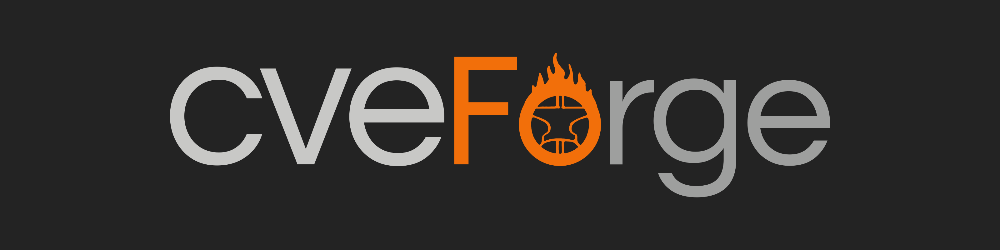
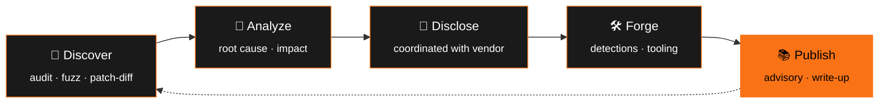
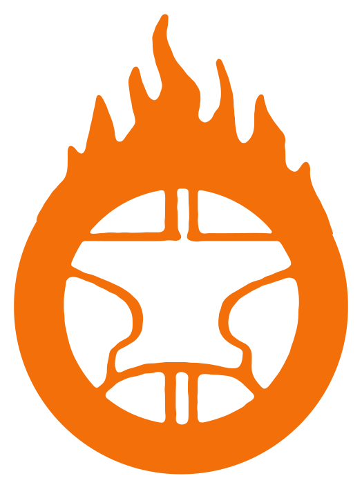

<!-- ═══════════════════════════ HEADER ═══════════════════════════ -->

  <picture>
    <source media="(prefers-color-scheme: dark)" srcset="https://raw.githubusercontent.com/cveForge/.github/main/assets/readme-banner-dark-3200x800@2x.png">
    <source media="(prefers-color-scheme: light)" srcset="https://raw.githubusercontent.com/cveForge/.github/main/assets/readme-banner-light-3200x800@2x.png">
    
  </picture>

  

  
  
  
  

  <a href="#-who-we-are">About</a> •
  <a href="#-what-we-do">What we do</a> •
  <a href="#-how-we-work">How we work</a> •
  <a href="#-disclosure-policy">Disclosure</a> •
  <a href="#-engineering-standards">Standards</a> •
  <a href="#-contributing">Contributing</a> •
  <a href="#-contact">Contact</a>

<!-- ═══════════════════════════ ABOUT ═══════════════════════════ -->

## 🔥 Who we are

**cveForge** is an independent, open-source security research organization.
We study how software breaks — and turn that knowledge into tools that help defenders find, understand and fix vulnerabilities **before** they are exploited.

Every line of code we publish is written with one question in mind:

> ***Does this make the defender's job faster, clearer or safer?***

If the answer is no, it doesn't ship.

<table>
<tr>
<td width="33%" valign="top">

### 🛡️ Defensive first
Our tooling is designed for blue teams, product security engineers, SOC analysts and independent researchers. Detection, triage and remediation come first.

</td>
<td width="33%" valign="top">

### ⚙️ Engineered in Rust
Memory-safe by default, fast without compromise. Security tools should not be the weakest link in your stack.

</td>
<td width="33%" valign="top">

### 🌐 Open by design
Permissive licenses, transparent research, reproducible results. Knowledge locked away doesn't protect anyone.

</td>
</tr>
</table>

<!-- ═══════════════════════════ FOCUS AREAS ═══════════════════════════ -->

## 🎯 What we do

<table>
<tr>
<td width="50%" valign="top">

#### 🔍 Vulnerability Research
Root-cause analysis of published CVEs, variant hunting across codebases and patch-diffing to understand what was actually fixed — and what wasn't.

#### 🧬 Reverse Engineering
Static and dynamic analysis of binaries, firmware and bytecode. Disassembly, decompilation and control-flow recovery tooling built for speed.

#### 🧩 Deobfuscation & Code Analysis
Unpacking and normalizing obfuscated code across multiple languages so analysts can read what software *really* does.

</td>
<td width="50%" valign="top">

#### 🦠 Malware Analysis
Behavioral and structural analysis of malicious samples, IOC extraction and signature development for detection pipelines.

#### 🌍 Network & Infrastructure Security
Routing security research, traffic inspection, DDoS mitigation and edge-defense engineering.

#### 🧪 Detection Engineering
Turning research into practical detections: rules, signatures, scanners and hardening guides that defenders can deploy today.

</td>
</tr>
</table>

<!-- ═══════════════════════════ WORKFLOW ═══════════════════════════ -->

## 🔁 How we work

Every research effort follows the same forge cycle — from raw finding to hardened defense:

| Stage | What happens | Output |
|:--|:--|:--|
| **Discover** | Code audits, fuzzing campaigns, patch diffing, threat-intel review | Candidate findings |
| **Analyze** | Root-cause analysis, exploitability and impact assessment, severity scoring | Technical report |
| **Disclose** | Private notification to the affected vendor or maintainer | Coordinated timeline |
| **Forge** | Build detection rules, scanners and mitigations around the finding | Open-source tooling |
| **Publish** | Advisory and technical write-up after a fix is available | Public knowledge |

<!-- ═══════════════════════════ DISCLOSURE ═══════════════════════════ -->

## 📨 Disclosure policy

We follow **Coordinated Vulnerability Disclosure (CVD)**. Our default process:

- 🔒 **Private first** — findings are reported privately to the vendor or maintainer before anything goes public.
- ⏳ **90-day window** — the standard deadline for a fix, extendable when the vendor is actively working in good faith.
- 🤝 **Collaboration** — we share reproduction details, analysis and suggested mitigations with the affected party.
- 📢 **Publish after fix** — advisories and write-ups are released once users have a reasonable chance to patch.
- 🚫 **No weaponization** — we never publish working exploits for unpatched vulnerabilities.

> [!IMPORTANT]
> Found a vulnerability **in one of our own projects**? Please don't open a public issue.
> Use **GitHub Private Vulnerability Reporting** on the affected repository (Security → *Report a vulnerability*).

<!-- ═══════════════════════════ STACK ═══════════════════════════ -->

## 🧰 Toolchain

  

| Layer | Technologies |
|:--:|:--|
| **Core engines** | Rust · Go |
| **Low level** | C / C++ · eBPF · x86-64 / ARM64 |
| **Portable** | WebAssembly · TypeScript |
| **Research & glue** | Python |
| **Infrastructure** | Linux · Docker · GitHub Actions |

<!-- ═══════════════════════════ STANDARDS ═══════════════════════════ -->

## 📐 Engineering standards

Security tools hold a privileged position — they run with high access, on sensitive data, inside critical environments. We hold ourselves to a high bar:

<b>🦀 Code quality</b>

 

- Memory-safe languages by default; `unsafe` blocks are minimized, isolated and documented
- `clippy` pedantic + `rustfmt` enforced in CI
- Fuzzing for every parser that handles untrusted input
- Reproducible builds wherever possible

<b>🔐 Supply chain</b>

 

- Dependencies audited with `cargo audit` / `cargo deny`
- Minimal dependency trees — fewer crates, smaller attack surface
- Signed releases and published checksums
- Dependabot and security advisories enabled on every repository

<b>📖 Documentation</b>

 

- Every tool ships with a clear README, usage examples and threat model
- Intended use and limitations are stated explicitly
- Changelogs follow [Keep a Changelog](https://keepachangelog.com)
- Versioning follows [SemVer](https://semver.org)

<b>⚖️ Responsible use</b>

 

- Tools are intended for **authorized** security testing, research and defense only
- We do not accept contributions designed to target systems without authorization
- Use of our software must comply with applicable laws and regulations

<!-- ═══════════════════════════ CONTRIBUTING ═══════════════════════════ -->

## 🤝 Contributing

We welcome researchers, engineers and curious minds. There are many ways to help:

| | Way to contribute | How |
|:--:|:--|:--|
| 🐛 | **Report bugs** | Open an issue with steps to reproduce |
| 💡 | **Suggest features** | Start a discussion describing the use case |
| 🧑‍💻 | **Submit code** | Fork → branch → PR with tests |
| 📝 | **Improve docs** | Typos, examples and guides are always welcome |
| 🔬 | **Share research** | Detection ideas, test samples, edge cases |

**Before your first PR:**
1. Read the repository's `CONTRIBUTING.md`
2. Make sure `cargo fmt`, `cargo clippy` and `cargo test` pass
3. Keep pull requests focused — one change per PR
4. Be respectful — our Code of Conduct applies everywhere

<!-- ═══════════════════════════ CONTACT ═══════════════════════════ -->

## 📬 Contact

| Purpose | Channel |
|:--|:--|
| 🔐 **Security reports** | GitHub Private Vulnerability Reporting on the affected repo |
| 💬 **Questions & ideas** | GitHub Discussions |
| 🐞 **Bugs** | GitHub Issues on the relevant repository |

<!-- ═══════════════════════════ FOOTER ═══════════════════════════ -->

 

  <picture>
    <source media="(prefers-color-scheme: dark)" srcset="https://raw.githubusercontent.com/cveForge/.github/main/assets/cveforge-mark-orange.svg">
    <source media="(prefers-color-scheme: light)" srcset="https://raw.githubusercontent.com/cveForge/.github/main/assets/cveforge-mark-orange.svg">
    
  </picture>

  <picture>
    <source media="(prefers-color-scheme: dark)" srcset="https://raw.githubusercontent.com/cveForge/.github/main/assets/cveforge-wordmark-dark.svg">
    <source media="(prefers-color-scheme: light)" srcset="https://raw.githubusercontent.com/cveForge/.github/main/assets/cveforge-wordmark-light.svg">
    
  </picture>

  <i>Every vulnerability understood is one less weapon in the wrong hands.</i>

  

